 

---

## Abstract

I am a Computer Engineering student at Fırat University, Faculty of Technology (Türkiye), and completed an Erasmus+ exchange period at Riga Technical University (RTU), Latvia, in Spring 2026. My background in computer networks and information security informs a current research and engineering focus on data systems: the design of reliable, secure, and performant infrastructure for the storage, transformation, and retrieval of data at scale.

My work is guided by three principles: that data in transit must be authenticated and encrypted, that data at rest must be organized so that access cost grows sub-linearly with volume, and that persistent state must remain consistent under concurrency and partial failure.

---

## Education and Experience

| Institution / Organization | Role / Program | Period |
|:--|:--|:--|
| Fırat University, Faculty of Technology | B.Sc., Computer Engineering | Ongoing |
| Riga Technical University (RTU), Latvia | Erasmus+ Exchange Student | Spring 2026 |
| *(Organization name)* | Data Engineering Intern | *(Period)* |

---

## Research Interests

### I. Secure Network Architecture

Modern distributed systems are exposed to adversaries at every layer of the protocol stack, which makes a single perimeter control insufficient. I study defense-in-depth architectures that combine stateful packet inspection at the network boundary, cryptographically protected transport (IPsec, TLS 1.3), and logical segmentation through virtual private clouds with private subnets. Access policy follows the principle of least privilege: access control lists and security groups default to deny, and the data tier is never directly reachable from untrusted networks.

---

### II. Indexing and Query Optimization

The cost of data retrieval is determined largely by access-path selection. In relational systems, the B+-tree remains the dominant index structure: a balanced, multiway search tree in which all records reside in a linked leaf level, giving point lookups in O(logb n) page accesses, where b is the branching factor, and efficient range scans through sequential leaf traversal. I am particularly interested in cost-based query planning, selectivity estimation from column statistics, and the trade-off between index maintenance overhead and read performance.

---

### III. Replication, Transactions, and Durability

Correctness under failure is the defining requirement of transactional storage. I study how write-ahead logging establishes durability and atomicity, how streaming replication propagates the log to standby nodes, and how synchronous quorum commit trades write latency for a bounded recovery point. Of particular interest are the isolation guarantees provided under concurrent access, and the position of a given configuration within the consistency, availability, and latency trade-off space.

---

### IV. Data Pipeline Engineering

A pipeline is a distributed system whose correctness depends on every stage. I approach ingestion, transformation, and serving as an end-to-end problem: sources must be authenticated and transported securely, transformations should be idempotent and deterministic so that failed runs can be replayed safely, and the serving layer must be modeled and indexed for its dominant query patterns.

---

## Technical Competencies

| Domain | Technologies |
|:--|:--|
| Programming Languages | Python, Java, Go, SQL, Bash |
| Database Systems | PostgreSQL, Oracle (in progress) |
| Cloud and Infrastructure | AWS (EC2, RDS, S3, IAM), Linux, Docker |
| Networking and Security | TCP/IP, Routing Protocols, VPC Design, Firewall Management, Cisco Networking |

 

  

---

## Selected Project

**HarvestGuard** is an autonomous agricultural system that combines obstacle detection with AI-based navigation, implemented in Python.

---

## Repository Statistics

  
  

---

## Contact

Open to collaboration in data engineering, database systems, and network security.

Email: behzatmedeni21@gmail.com
